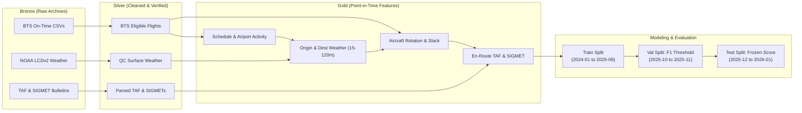

# Scalable Flight Delay Prediction Pipeline

[](https://www.python.org/)
[](https://spark.apache.org/)
[](https://spark.apache.org/mllib/)
[-lightgrey?style=flat-square)](#pipeline-flowchart)

An end-to-end **PySpark** machine learning pipeline that predicts whether U.S. domestic flights will arrive at least 15 minutes late (`ArrDel15`) using only information available **at scheduled departure**. It combines Bureau of Transportation Statistics (BTS) flight records, NOAA surface weather, aviation forecasts/advisories (TAF/SIGMET), and aircraft tail-number rotations under strict chronological splitting.

---

## What This Project Does

* **Exploratory Data Analysis (EDA):** Inspects BTS flight schedules, delay prevalence, and NOAA weather coverage in `notebooks/`.
* **End-to-End Medallion Pipeline:** Ingests, cleans, and joins multi-source data (Bronze $\rightarrow$ Silver $\rightarrow$ Gold) with cryptographic caching and cohort-identity checks.
* **Machine Learning & Validation:** Fits `LogisticRegression` (unweighted and class-weighted) and `RandomForestClassifier` on training data, then tunes $F_1$ decision thresholds on validation data.
* **Frozen Test Evaluation & Reporting:** Scores held-out test flights with saved `PipelineModel` artifacts and publishes metrics, subgroup slices, and stage timings to `results/`.

---

## Pipeline Flowchart



---

## Tech Stack

| Layer | Technology | Purpose |
| :--- | :--- | :--- |
| **Distributed Engine** | Apache Spark 3.5 / PySpark | Large-scale ETL, temporal joins, and MLlib pipelines |
| **Runtime** | Python 3.11 / Java 17 | Core pipeline logic and JVM Spark execution |
| **Storage** | Apache Parquet (Snappy) | Partitioned Bronze $\rightarrow$ Silver $\rightarrow$ Gold tables |
| **ML & Evaluation** | Spark MLlib / Pandas | `LogisticRegression`, `RandomForestClassifier`, threshold tuning |
| **Testing** | Pytest | Unit tests and synthetic Spark integration/smoke tests |
| **Environment** | Conda / Hadoop 3.3 (`winutils`) | Reproducible dependencies and Windows local Spark I/O |

---

## Requirements & Setup

### Prerequisites
* [Miniconda](https://docs.conda.io/en/latest/miniconda.html) or [Anaconda](https://www.anaconda.com/)
* Git

### Installation
```bash
git clone https://github.com/girwandhakal/flight-delay-pipeline.git
cd flight-delay-pipeline

conda env create -f envs/environment.yml
conda activate cs523_project_env
```
*(Windows: `envs/hadoop/bin/` is pre-configured automatically by `scripts/common/spark.py`.)*

---

## How to Run

| Task | Command | Notes |
| :--- | :--- | :--- |
| **Full Pipeline (Prepare, Train, Validate)** | `python pipeline/main.py` | Runs Stages 1–6, saves run to `models/flight_delay/<RUN_ID>/`, updates `results/results.json` |
| **Frozen Test Scoring** | `python -m scripts.modeling.evaluate <RUN_ID>` | Scores the completed run on the held-out test split and publishes test metrics |
| **Fast Unit Tests** | `python -m pytest -m unit` | Pure-Python checks (no Spark JVM) |
| **Pipeline Smoke Test** | `python -m pytest tests/test_pipeline_smoke.py` | End-to-end synthetic Gold fit and test scoring |
| **Full Test Suite** | `python -m pytest` | Runs all unit and Spark integration tests |

<details>
<summary>Run individual data stages separately</summary>

```bash
python -m scripts.bts.download
python -m scripts.bts.clean
python -m scripts.bts.build_features
python -m scripts.origin_weather.download
python -m scripts.origin_weather.clean
python -m scripts.origin_weather.build_features
```

</details>

---

## Project Directory

```text
├── config.json                 # Study dates, data sources, and weather/split policy
├── pipeline/main.py            # Sequential stage orchestrator (Stages 1–6)
├── scripts/
│   ├── common/                 # Config, Spark session, I/O, caching, and results
│   ├── bts/                    # Stage 1: BTS ingestion, cleaning, and features
│   ├── origin_weather/         # Stage 2: NOAA LCDv2 ingestion, QC, and origin matching
│   ├── destination_weather/    # Stage 3: Destination weather at scheduled departure
│   ├── aircraft_rotation/      # Stage 4: Tail-number linkage and turnaround slack
│   ├── enroute_weather/        # Stage 5: TAF and SIGMET enrichment
│   └── modeling/               # Stage 6: Training, validation, and frozen test scoring
├── notebooks/                  # Exploratory data analysis (BTS & origin weather)
├── tests/                      # Unit, integration, and pipeline smoke tests
├── envs/                       # Conda environment, pip requirements, and winutils
├── data/                       # Bronze, Silver, Gold, Quarantine, and Reference data
├── models/flight_delay/        # Saved PipelineModels, thresholds, and run manifests
└── results/                    # Published metrics (results.json) and stage timings
```

---

## Author
**Girwan Dhakal** — The University of Alabama (CS 523: Python for Big Data)  
GitHub: [@girwandhakal](https://github.com/girwandhakal)
